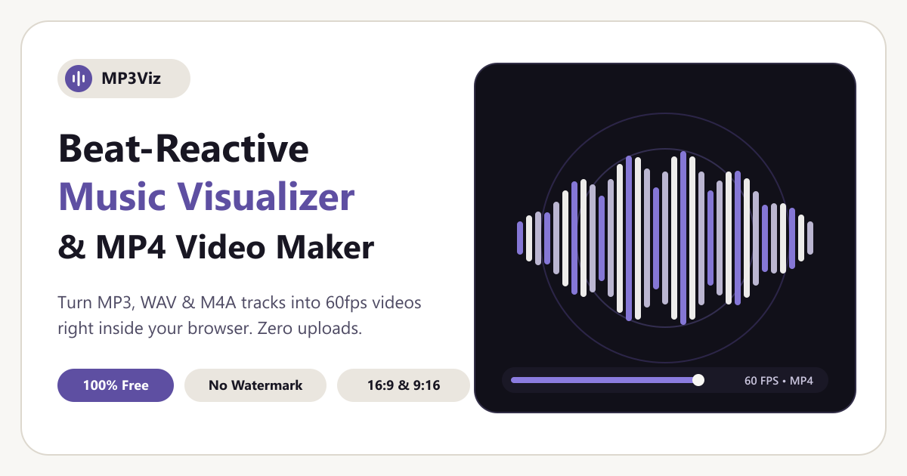
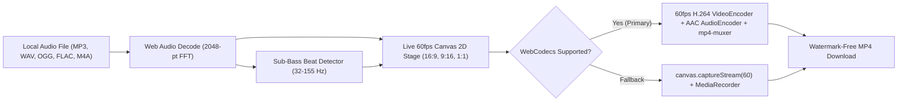

<div align="center">


# MP3Viz

### Beat-Reactive Music Visualizer & Client-Side 60fps MP4 Video Maker

[](https://mp3viz.github.io/)
[](https://astro.build/)
[](https://react.dev/)
[](#audio-visual--60fps-mp4-pipeline)
[](LICENSE)

<p align="center">
  <a href="https://mp3viz.github.io/"><strong>Launch Live App</strong></a> ·
  <a href="https://mp3viz.github.io/how-to-use/"><strong>How to Use</strong></a> ·
  <a href="#key-features"><strong>Features</strong></a> ·
  <a href="#local-development"><strong>Local Setup</strong></a> ·
  <a href="https://mp3viz.github.io/hire-me/"><strong>Hire the Developer</strong></a>
</p>

<br />

<a href="https://mp3viz.github.io/">
  
</a>

</div>

---

## Overview

**MP3Viz** ([https://mp3viz.github.io/](https://mp3viz.github.io/)) is a fast, distraction-free, **100% browser-executed** audio spectrum visualizer and downloadable MP4 video studio. Musicians, beatmakers, podcasters, and social creators can drop local `MP3`, `WAV`, `OGG`, `FLAC`, or `M4A` tracks directly onto the stage, customize beat-reactive visuals, aspect ratios, cover artwork, and track titles, and export a smooth **60fps H.264 + AAC `.mp4` video**—completely free, with **zero watermarks** and **zero server uploads**.

---

## Key Features

| Capability | Implementation Details |
| :--- | :--- |
| **Sub-Bass Beat Detection** | Real-time `2048`-point Fast Fourier Transform (`AnalyserNode` + calibrated Blackman window `[-95 dB, -18 dB]`) isolating `32–155 Hz` kick transients for responsive pulse scaling without clipping on mastered tracks. |
| **4 Visualizer Presets** | **Bars Spectrum** (symmetrical rounded bars + peak indicators), **Radial Neon Ring** (medallion + dual-tone radial spikes), **Mirrored Wave** (harmonic ribbons + live oscilloscope), and **Particle Beat Pulse** (concentric bass shockwaves + orbital starfield). |
| **Social Video Aspect Ratios** | Instant zero-CLS switching across **16:9 YouTube** (`1280×720`), **9:16 Shorts / TikTok / Reels** (`720×1280`), and **1:1 Square** (`1080×1080`). |
| **Visual Customization** | Curated studio color swatches, custom spectrum & stage hex pickers, optional cover/background artwork with gentle bass-hit zoom, and on-canvas **Song Title** & **Artist** overlays. |
| **True 60fps MP4 Export** | Hardware-accelerated WebCodecs (`VideoEncoder` Constrained Baseline H.264 Level 4.2 + `AudioEncoder` AAC/Opus) muxed in memory via [`mp4-muxer`](https://github.com/Vanilagy/mp4-muxer) with strict queue backpressure (`PTS === DTS`, zero dropped frames) + automatic `MediaRecorder` fallback. |
| **100% Client-Side Privacy** | Unreleased songs, voiceovers, and artwork never leave the user's device. Ships with zero third-party analytics or tracking scripts. |
| **Installable Offline PWA** | Full offline studio & video rendering after clicking **Add to Home Screen** (`manifest.webmanifest` + cache-first Service Worker `sw.js`). |
| **Accessible Light & Dark UI** | Warm Alabaster (`#F8F7F4`) and Deep Studio Dark (`#111019`) themes meeting **WCAG AA (`>= 4.5:1`)** contrast, minimal distraction-free navigation, keyboard-accessible dropzone, and `aria-live="polite"` status announcements. |

---

## Audio-Visual & 60fps MP4 Pipeline



### Why Exported Videos Play Smoothly Without Stuttering
- **Zero B-Frame Reordering (`PTS === DTS`):** Prioritizes Constrained Baseline / Baseline H.264 Level 4.2 (`avc1.42e02a` / `avc1.42002a`) with `latencyMode: 'quality'`, preventing out-of-order presentation timestamp jitter across Windows Media Player, QuickTime, VLC, iOS, and mobile browsers.
- **Dequeue-Driven Backpressure:** Throttles `VideoEncoder` queue depth (`<= 3` frames in flight) via native `dequeue` events so GPU D3D11/VideoToolbox surface pools never overflow or drop frames.
- **Drift-Free Microsecond Timestamps:** Computes integer frame durations from cumulative timestamp deltas (`round((i+1)*1e6/60) - round(i*1e6/60)`), producing a uniform `60.000 fps` `stts` sample table.

---

## Tech Stack

- **Static Framework:** [Astro 5](https://astro.build/) (Islands Architecture — `0 KB` client JS on static guide and freelance pages)
- **Interactive Studio Island:** [React 19](https://react.dev/) + [TypeScript 5](https://www.typescriptlang.org/) (`client:load`)
- **Styling & Design Tokens:** [Tailwind CSS](https://tailwindcss.com/) + CSS Custom Properties (`data-theme="light" | "dark"`)
- **Media & Muxing Engine:** Web Audio API, HTML5 Canvas 2D, WebCodecs API, [`mp4-muxer`](https://www.npmjs.com/package/mp4-muxer), MediaRecorder API
- **CI/CD Hosting:** GitHub Actions → GitHub Pages

---

## Project Structure

```text
mp3viz.github.io/
├── .github/
│   ├── workflows/
│   │   └── deploy.yml              # Automated Astro build & GitHub Pages deployment
│   └── FUNDING.yml                 # Developer sponsorship link
├── public/
│   ├── icons/                      # 192×192 & 512×512 PWA maskable app icons
│   ├── favicon.svg                 # Vector soundwave brand mark
│   ├── manifest.webmanifest        # Standalone PWA manifest
│   ├── og-image.png                # Static 1200×630 Open Graph / Twitter preview card
│   ├── robots.txt                  # Crawler directives & Sitemap reference
│   └── sw.js                       # Cache-first offline Service Worker
├── src/
│   ├── components/
│   │   ├── AudioVisualizerIsland.tsx # Hydrated React 19 visualizer & MP4 export studio
│   │   ├── Breadcrumbs.astro       # Semantic subpage breadcrumb trail
│   │   ├── Footer.astro            # Studio footer & navigation links
│   │   ├── HireMeView.astro        # Freelance services view & one-click email copy
│   │   ├── HomeView.astro          # Hero workspace + 4-question FAQ + JSON-LD
│   │   ├── HowToUseView.astro      # Step-by-step creator guide + HowTo JSON-LD
│   │   └── Navbar.astro            # Minimal top bar + secondary settings toggle menu
│   ├── i18n/
│   │   └── translations.ts         # Complete human translations across 8 languages
│   ├── layouts/
│   │   └── BaseLayout.astro        # SEO head, canonicals, hreflang, OG & theme init
│   ├── lib/
│   │   ├── fftEngine.ts            # 2048-point Blackman FFT & sub-bass beat detector
│   │   ├── sampleBeat.ts           # In-memory stereo 120 BPM sample groove synthesizer
│   │   ├── videoExporter.ts        # 60fps WebCodecs + mp4-muxer & MediaRecorder engine
│   │   └── visualizerRenderer.ts   # Hardware-accelerated Canvas 2D preset renderers
│   ├── pages/
│   │   ├── [lang]/                 # Localized routes (es, pt, de, fr, ja, zh, ru)
│   │   ├── hire-me/index.astro     # English /hire-me/ route
│   │   ├── how-to-use/index.astro  # English /how-to-use/ route
│   │   ├── index.astro             # English / home studio route
│   │   └── sitemap.xml.ts          # Flat Google Search Console <urlset> endpoint
│   └── styles/
│       └── global.css              # Light/Dark WCAG AA tokens & studio transitions
├── astro.config.mjs
├── package.json
├── tailwind.config.mjs
└── tsconfig.json
```

---

## Internationalization (8 Languages)

Every route (`Home`, `How to Use`, and `Hire Me` — **24 static pages total**) is localized with reciprocal `<link rel="alternate" hreflang="...">` tags, `x-default` fallbacks, and flat XML sitemap entries:

| Code | Language | Route Prefix |
| :--- | :--- | :--- |
| `en` | English *(Default)* | `/` |
| `es` | Español | `/es/` |
| `pt` | Português | `/pt/` |
| `de` | Deutsch | `/de/` |
| `fr` | Français | `/fr/` |
| `ja` | 日本語 | `/ja/` |
| `zh` | 简体中文 | `/zh/` |
| `ru` | Русский | `/ru/` |

---

## Local Development

### Prerequisites

- **Node.js** `>= 20.0.0`
- **npm** `>= 10.0.0`

### Quick Start

```bash
# 1. Clone the repository
git clone https://github.com/mp3viz/mp3viz.github.io.git
cd mp3viz.github.io

# 2. Install dependencies
npm install

# 3. Start the Astro development server
npm run dev
```

### Production Build & Verification

```bash
# Run strict Astro + TypeScript diagnostics and build static output into ./dist
npm run build

# Serve the production build locally
npm run preview
```

---

## Deployment (GitHub Pages)

Production builds deploy automatically via [`.github/workflows/deploy.yml`](.github/workflows/deploy.yml):

1. Open your repository on GitHub and navigate to **Settings → Pages**.
2. Under **Build and deployment → Source**, select **GitHub Actions**.
3. Push commits to `main` (or trigger **Deploy MP3Viz to GitHub Pages** manually from the **Actions** tab) to publish directly to `https://mp3viz.github.io/`.

---

## Author, Support & Custom Development

Designed and engineered by **Kishara Dilshan**.

- **Need a Custom Web, Media, or WebAssembly Application?** Visit [https://mp3viz.github.io/hire-me/](https://mp3viz.github.io/hire-me/) or email [`kisharadilshan007@gmail.com`](mailto:kisharadilshan007@gmail.com) for ultra-fast Astro, React, Next.js, and client-side browser tools.
- **Support Open-Source Work:** [Buy Me a Coffee on Gumroad](https://kisharadilshan.gumroad.com/coffee)

---

## License

Released under the [MIT License](LICENSE). Copyright © 2026 Kishara Dilshan.
